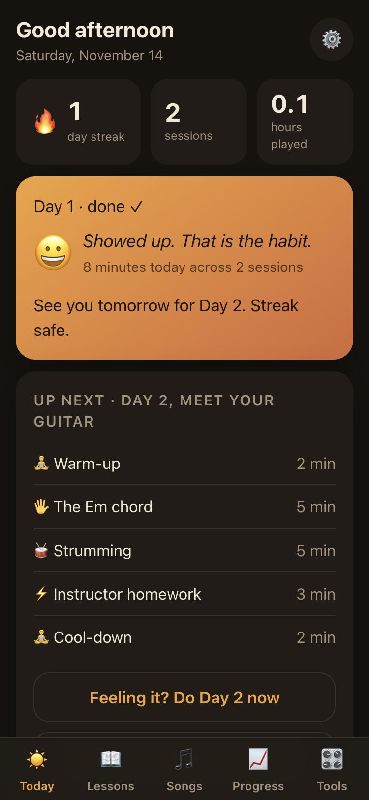
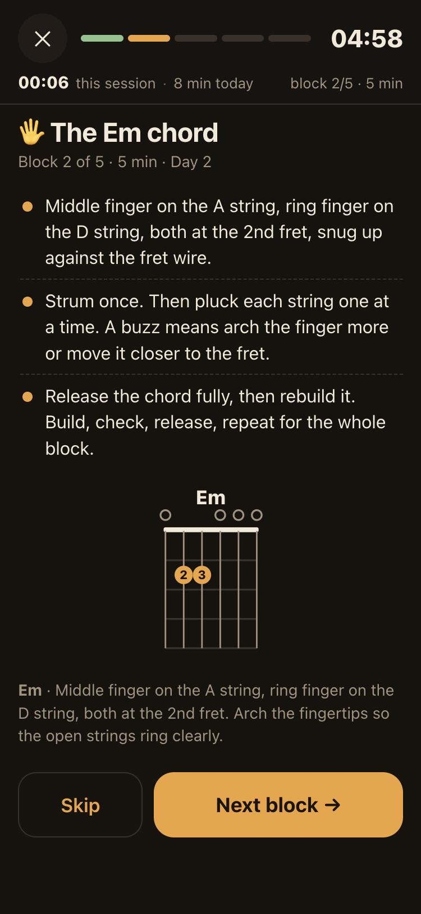
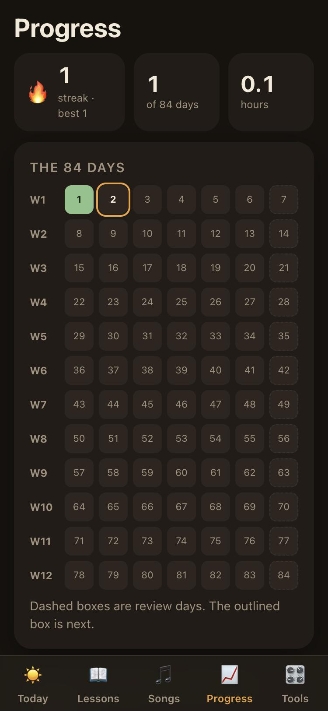

# Guitar Habit

Fifteen minutes a day. Three acoustic songs in twelve weeks. A tiny self-hosted practice app for
absolute beginners: it runs on a Mac (or any machine with Node) and you use it from your phone.

No accounts, no cloud, no dependencies, no build step. One Node file serves a vanilla JS web app and
keeps your progress in a single JSON file.

<p align="center">
  
  
  
</p>

## Features

- **A 12-week program as data.** 84 days of timed blocks: warm-up, chord drill, strumming, play-along,
  cool-down. Each week is a function of the day, so a week definition produces seven varied sessions.
- **Three songs, chord charts only.** A Horse with No Name (Em, D6/9) in weeks 1 to 8, Knockin' on
  Heaven's Door (G, D, Am, C) in weeks 9 to 12, and Three Little Birds (A, D, E) as the instructor song.
  Structure, tempo and chords. No lyrics.
- **Built-in tools.** Web Audio lookahead metronome with strumming patterns and a count-in, animated
  play-along that scrolls the chord bars, SVG chord diagrams with finger numbers, reference tuner tones,
  and a one-minute chord-change counter with personal bests.
- **Completion-based progression.** Finishing a session advances the day. Missing days breaks the streak,
  never skips content. A 5-minute fallback keeps the streak alive on bad days.
- **Lessons browser.** Read or replay any day. Replays count as practice but never move the program forward.
- **Instructor homework.** Type the chords your teacher assigned and every session gets a short block:
  shapes one day, a changes round on one pair the next, a slow play-along once the list covers a song.
- **Honest time tracking.** A sticky session clock logs real wall-clock minutes, with a running day total
  and a minutes-per-day chart.
- **Streaks, badges, confetti.** Because habits need a little dopamine.
- **Phone first.** Add it to the iPhone home screen and it runs full screen. Dark and light themes.
  Works around iOS muting browser audio on the silent switch.

## Run it

Requires Node.js 18 or newer.

```bash
git clone https://github.com/jasti/guitar-habit.git
cd guitar-habit
node server.js
```

Open `http://localhost:4321` on the computer, or from your phone on the same Wi-Fi:

```
http://<your-computer-name>.local:4321
```

The server prints the exact addresses, including the LAN IP, when it starts. `PORT=8080 node server.js`
changes the port.

### Start at login on macOS

```bash
./install-service.sh
```

This writes a LaunchAgent for the current folder and loads it, so the app starts at login and restarts
if it crashes. Logs go to `data/server.log`. Remove it with `./install-service.sh uninstall`.

### Put it on the iPhone home screen

1. Open the address above in Safari.
2. Tap Share, then **Add to Home Screen**.
3. It opens full screen like an app.

No sound on the iPhone? Flip the Ring/Silent switch to ring and turn the volume up. iOS mutes browser
audio on silent; the app plays a silent clip on every tap to work around it, but that does not always
win. Tools has a **Test sound** button. After the phone locks, the first tap wakes the audio up again.

Tip: iPhone screens lock during long blocks. Set Settings → Display & Brightness → Auto-Lock to
5 minutes, or tap the screen now and then. The block timer chimes when time is up.

## What is where

| Path | What it is |
| --- | --- |
| `server.js` | Node server, no dependencies. Static files plus a small JSON API. |
| `public/curriculum.js` | The whole program as data: chords, patterns, songs, 12 weeks of blocks. Edit freely. |
| `public/app.js` | The client: session runner, metronome, chord trainer, play-along, progress. |
| `data/state.json` | Your progress. One file, never committed. Back it up or export it from Settings. |

## How progression works

- **Completion based, not calendar based.** Finishing a session advances to the next day. Missing
  a day never skips content; it only breaks the streak. The app says so when you come back.
- **Streak** counts consecutive calendar days with at least one session.
- **Only have 5 minutes?** runs a trimmed two-block version of the day. It still counts, still advances.
- **One-minute changes** are logged per chord pair with personal bests, charted on the Progress tab.
- **Clean tempo** per song is logged from any play-along with "That tempo felt clean".
- **Badges** for the first session, 7 and 30 day streaks, coming back after a gap, each song, and more.
- **Session clock.** A sticky header shows the block countdown, the real time spent so far this session, and
  your running total for the day. Sessions log wall-clock time, not planned time.
- **Lessons tab** lists all 84 days. Open any day to read it or replay it. Replays log practice
  (streak, minutes, changes) but never move the program forward, so previewing day 40 doesn't skip days 2 to 39.
- **Instructor homework** (Settings): list the chords your teacher assigned, for example `A, D, E, G, C`,
  and every session gets a short extra block. The pairs also appear first in the Tools changes counter.
- Settings lets you set the current day by hand to repeat a week or skip ahead, and reset with a backup.

## API

| Call | Does |
| --- | --- |
| `GET /api/state` | Full state plus computed stats |
| `POST /api/session` | Log a session `{date, day, minutes, seconds, mood, win, short, replay}` |
| `POST /api/metric` | Log `{type:'changes', pair, count}` or `{type:'tempo', song, bpm}` |
| `POST /api/profile` | Set `{name}`, `{currentDay}`, or `{homework: {chords, minutes}}` |
| `GET /api/export` | Download the state file |
| `POST /api/reset` | `{confirm:'RESET'}`, keeps a backup in `data/` |

## Changing the program

Everything is in `public/curriculum.js`. To add a song, add an entry to `SONGS` with its chords,
tempo, pattern and sections, and any chord shapes it needs to `CHORDS`. Mark it `instructor: true`
and the homework block will rotate it in once the homework chords cover it. Weeks are functions of
the day-in-week, so one week definition produces seven varied days. Reload the page, no build step.

The song charts are practice structures (which chord, how many bars), not transcriptions. Listen to the
records for the feel and the words.

## License

MIT. See [LICENSE](LICENSE).
